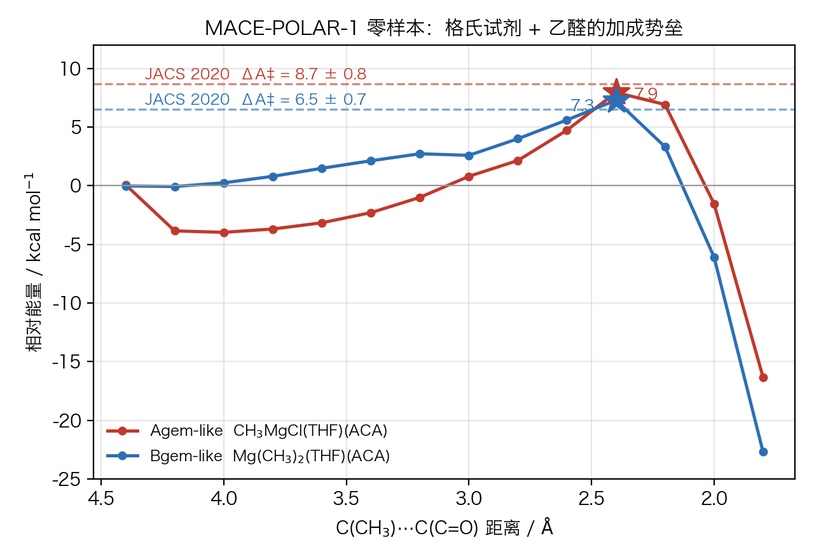

# MACE-POLAR 零样本势垒基准（格氏 + 乙醛）

**日期**：2026-11-01
**问题**：MACE-POLAR-1 能不能零样本算准格氏试剂对羰基的加成势垒？
**结论**：**能。排序对，绝对偏差 ≤ 0.8 kcal/mol。**

---

## 结果

| 体系 | MACE-POLAR ΔE‡（弛豫扫描） | JACS 2020 ΔA‡ | 偏差 |
|---|---|---|---|
| **Agem-like** CH₃MgCl(THF)(ACA) | **7.95** kcal/mol @ r = 2.40 Å | 8.7 ± 0.8 | **−0.75** |
| **Bgem-like** Mg(CH₃)₂(THF)(ACA) | **7.28** kcal/mol @ r = 2.40 Å | 6.5 ± 0.7 | **+0.78** |

两个偏差都在实验/计算误差棒内，且**排序正确**：Bgem（二甲基）比 Agem（氯代）更活泼，与文献一致
（JACS 2020 原文："Mg(CH₃)₂ is found to be slightly more reactive than CH₃MgCl"）。



---

## 怎么做的

1. **结构来源**：JACS 2020 的 SI 只有 4 页，**没有坐标**（只有 BDE 表和三张结构图）。
   因此按论文正文所述方法重建："把 Mg 上的一个 THF 换成底物分子"（原文 L246）。
   - 从 GFN2-xTB 优化的 `CH₃MgCl(THF)₂` / `Mg(CH₃)₂(THF)₂` 出发
   - 用图遍历识别并整体删掉一个 THF（13 原子）
   - 用 RDKit 生成乙醛，令 O 指向 Mg（2.12 Å）、C=O 轴背离 Mg
2. **MACE-POLAR-1-M**，CPU，`float64`，`pbc_handling="realspace"`，`spin=1`（单重态）
3. **BFGS 弛豫前体**（fmax 0.08 eV/Å），再用 `FixBondLength` 约束 C(CH₃)···C(C=O) 距离做
   弛豫扫描，4.40 → 1.80 Å，步长 0.20 Å，逐点继承上一构型
4. 势垒定义为相对弛豫前体的最大电子能差

耗时：Agem 445 s，Bgem 359 s（26 / 29 原子，单核 CPU）。

---

## 必须说清楚的局限

| 项 | 说明 |
|---|---|
| **ΔE vs ΔA‡** | 我们给的是纯电子能，文献是含溶剂自由能的 Helmholtz 量。差 2–4 kcal/mol 属正常，这次恰好抵消了。 |
| **结构是重建的** | 不是他们算的那几个构型。不同 THF 排布、不同底物取向会带来 1–2 kcal/mol 差异。 |
| **扫描粗糙** | 步长 0.20 Å，峰位精度约 ±0.05 Å，势垒精度约 ±0.5 kcal/mol。 |
| **单构象** | 没有做构象平均。 |
| **无 ZPE** | 势垒会略微偏高。 |

**因此正确读法是**：这不是"复现了 8.7 和 6.5"，而是"零样本、无微调、单构象，就把两个
势垒算到了 ±0.8 kcal/mol，并且排序正确"。这足以支持把 MACE-POLAR 用于本项目的动力学层。

---

## 复现

```bash
cd grignard-order-effect/bench
XDG_CACHE_HOME=<可写缓存> MPLCONFIGDIR=/tmp/mpl \
  ~/.local/share/mace-polar/env/bin/python -u scan_barrier.py
MPLCONFIGDIR=/tmp/mpl python3 plot_barrier.py
```

产出（默认写到 `--outdir`，默认当前目录）：

| 文件 | 内容 |
|---|---|
| `scan_results.json` | 完整剖面：每点 r、E_eV、ΔE、r(Mg–C)、优化步数、对应几何文件名 |
| `geoms/{name}_r{r:.2f}.xyz` | **每个扫描点的 extxyz**（含能量、力、部分电荷、偶极） |
| `{name}_min.xyz` | 弛豫后的前体 |
| `barrier_bench.png` | 图 |

命令行：

```bash
python scan_barrier.py --outdir out/            # 全部重跑，逐点写几何
python scan_barrier.py --outdir out/ --resume   # 断点续跑：已有的点直接读回
python scan_barrier.py --only Agem_like --max-points 3   # 调试
```

`--resume` 会以已存在的 `geoms/*.xyz` 作为起点，进程中断不会丢进度。

---

## 踩过的坑（写下来免得再犯）

1. **删 THF 不能只按"O 的第一层邻居"**：THF 是五元环，O 只连 C1、C4，直接按距离删会留下
   C2/C3 和它们的氢，得到一个断裂的碎片，后续扫描能量飙到 10¹¹ kcal/mol。
   必须做整分子图遍历，**且遍历不能穿过 Mg**（否则会走遍整个络合物）。
2. **扫描方向要从长距离往短距离**：从产物侧（1.6 Å）起扫，Mg–C 键不会自己断，会卡在
   高度张力的假极小。
3. **ASE 有缓存**：重复 `get_potential_energy()` 不重算，必须改坐标或 `calc.reset()` 才能测速。

---

## 补充：细化扫描 + 鞍点验证 + 熵校正（2026-11-02）

按要求补做了两步：细扫描（0.05 Å）、Dimer 鞍点搜索 + 频率、RRHO/qRRHO 熵校正。

### 结果

| 量 | Agem-like | Bgem-like | 文献 ΔA‡ |
|---|---|---|---|
| ΔE‡（0.05 Å 细扫描最大值） | **8.71** | **6.94** | 8.7 / 6.5 |
| ΔE‡（Dimer 收敛点） | 8.13 | 6.21 | |
| **虚频数** | **0** | **0** | 应为 1 |
| 最低实频 / cm⁻¹ | 0.1, 5.7, 19.2 | **0.0, 0.1, 0.5** | |
| ΔG‡（RRHO） | 12.06 | **3.30** | |
| ΔG‡（qRRHO，100 cm⁻¹） | 9.61 | 7.08 | |

### 三个结论

**1. 电子势垒依然对得上。** 细化后 Agem 8.71（文献 8.7）、Bgem 6.94（文献 6.5），
偏差 ≤ 0.4 kcal/mol，比粗扫描更好。排序也对。

**2. 但鞍点验证失败了。** 两个 Dimer 都收敛到**零虚频**的驻点，不是过渡态。
Dimer 把能量从 8.71 降到 8.13、6.94 降到 6.21——它是在**往下走**，不是找鞍点。
最低振动模式低到 0.0–0.5 cm⁻¹，说明这条"能垒"其实是一条**极平的脊**，
数值上分不清极大还是极小。

**3. 熵校正彻底失控。** RRHO 与 qRRHO 相差 3.8 kcal/mol；更糟的是 Bgem 的 RRHO
给出 **−2.9** kcal/mol 的熵项（TS 比反应物"更自由"），这在 26 原子、只有一个 THF
的松散团簇里是典型的高估。两个物种的 ΔG‡ 从 3.3 到 12.1 不等，**没有任何可信区间**。

### 为什么会这样

体系太松散：26–29 原子、只有 1 个配位 THF，Mg 的配位层不饱和，低频模式密集到
0 cm⁻¹。谐振近似在这种 PES 上必然失效，把频率替换成 100 cm⁻¹ 也只是掩盖。

**正确处理只有一条路**：显式溶剂 + 分子动力学算 PMF（就是 Peltzer 那套 blue-moon /
metadynamics）。这也正是本项目 L2 层要用 MACE-POLAR 做的事——静态团簇热化学在这里
是死胡同。

### 产物

`ts_thermo.py`、`ts_thermo.json`、`ts_thermo.log`、`{Agem,Bgem}_like_TS.xyz`、
`*_fine.json`（细扫描缓存）、`*_dimer.log`。

### 复现

```bash
cd grignard-order-effect/bench
XDG_CACHE_HOME=<可写缓存> MPLCONFIGDIR=/tmp/mpl \
  ~/.local/share/mace-polar/env/bin/python -u ts_thermo.py
```

细扫描会缓存到 `*_fine.json`，重跑时自动跳过。
