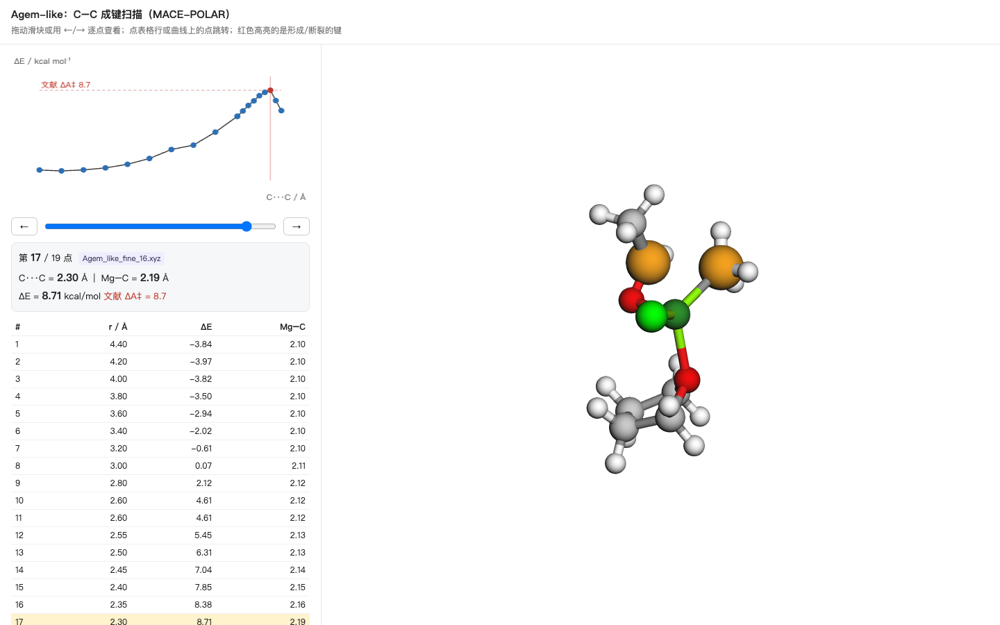

# 操作手册：自己动手跑 MACE-POLAR

目标：每一条命令都**立刻打印人能读的东西**，跑完落一个能点的看板。不用等后台，不用读 JSON。

---

## 0. 先试试这条

```bash
cd grignard-order-effect/bench
./mp view Agem_like_fine_00.xyz --out /tmp/a.html
open /tmp/a.html
```

浏览器里出现一个可以转的 3D 结构。**这就是所有命令的底层视图。**

---

## 1. 单点：这个结构能量多少、电荷怎么分布

```bash
./mp sp Agem_like_min.xyz
```

```
原子数          26
能量            -29566.422856 eV
最大力          0.0642 eV/Å
部分电荷（按元素平均）
  C    n= 7   mean=-0.065 e
  Cl   n= 1   mean=-0.736 e
  Mg   n= 1   mean=+1.221 e
  O    n= 2   mean=-0.042 e
  合计 +0.0000 e
```

用法：改一个结构，跑一次，看 Mg 的电荷有没有变。这是最便宜的"探针"。

---

## 2. 优化：把这个结构relax到底

```bash
./mp opt my.xyz --fmax 0.05 --steps 400
```

每 5 步打印一次能量和最大力，结束时给出 ΔE 和最终结构 `my_opt.xyz`。

**中途想停**：Ctrl-C。已经打印的步数就是进度。

---

## 3. 扫描：沿一根键推着走（这次的核心操作）

```bash
./mp scan Agem_like_min.xyz --i 1 --j 20 --r 4.4:1.8:0.2 --lit 8.7
```

- `--i 1 --j 20`：**0-based 原子编号**，第 2 个和第 21 个原子（C 和羰基 C）
- `--r 4.4:1.8:0.2`：从 4.40 Å 到 1.80 Å，步长 0.20
- `--lit 8.7`：在看板上画一条文献参考线

跑的时候逐点打印：

```
  r= 2.60  ΔE=   4.61 kcal/mol   Mg–C=2.12 Å   (18 步)
  r= 2.45  ΔE=   7.04 kcal/mol   Mg–C=2.14 Å   (24 步)
```

跑完自动生成：

| 产物 | 位置 |
|---|---|
| 每个点的几何 | `scan_out/geoms/Agem_like_min_r2.45.xyz` |
| 完整剖面 | `scan_out/Agem_like_min_scan.json` |
| **可交互看板** | `scan_out/Agem_like_min_dashboard.html` |

```bash
open scan_out/Agem_like_min_dashboard.html
```

---

## 4. 看板怎么用（这是"掌控"的地方）



| 操作 | 效果 |
|---|---|
| 拖滑块 / `←` `→` | 逐点切换构象 |
| 点曲线上的点 | 跳到那一帧 |
| 点表格行 | 同上 |
| 鼠标拖动 / 滚轮 | 转、缩放 |

橙色高亮的两个球就是 **你指定的 i、j**——一眼能看出这根键在断还是在成。

左侧读数实时给出 `C···C`、`Mg–C`、`ΔE`，以及文献参考值。

**这就是分析**：看势垒出现在哪个 r、那时 Mg–C 断了没有、结构有没有崩。

---

## 5. 常见改法

**换一根键**：改 `--i/--j`。编号是 xyz 里的顺序（从 0 开始）：

```bash
head -8 Agem_like_min.xyz     # 第 3 行起是 0 号原子
```

**换扫描范围**：`--r 3.0:1.6:0.05`（细一点，慢一点）

**只想看不算**：`./mp view my.xyz`

**把已经算完的数据重新出图**：

```bash
./mp view --json Agem_like_fine.json --glob 'Agem_like_fine_*.xyz' \
          --lit 8.7 --i 1 --j 20 --out Agem.html
```

---

## 6. 速度参考（CPU）

| 体系 | 每步 |
|---|---|
| 26 原子 | ~0.4 s |
| 32 原子 | ~0.5 s |
| 55 原子 | ~0.95 s |

一个 14 点的扫描 ≈ 10–15 分钟。

---

## 7. 两个容易踩的坑

1. **`--spin` 是多重度 2S+1**，闭壳层单重态填 `1`，不是 `0`。
2. **扫描方向要从长到短**（4.4 → 1.8）。反过来从产物侧起扫，Mg–C 不会自己断，会卡在假极小。

---

## 8. 现在手上有什么可玩的

| 文件 | 内容 |
|---|---|
| `Agem_dashboard.html` | Agem 的 19 点扫描，已做好 |
| `Bgem_dashboard.html` | Bgem 的 19 点扫描 |
| `Agem_like_min.xyz` / `Bgem_like_min.xyz` | 两个前体络合物 |
| `Agem_like_TS.xyz` / `Bgem_like_TS.xyz` | 之前 Dimer 找到的"TS"（0 虚频，存疑） |

建议第一件事：打开 `Agem_dashboard.html`，把滑块从 19 拖到 1，看 **Mg–C 是在哪一帧开始断的**——这直接回答"我算的那个最高点到底是不是协同过渡态"。
